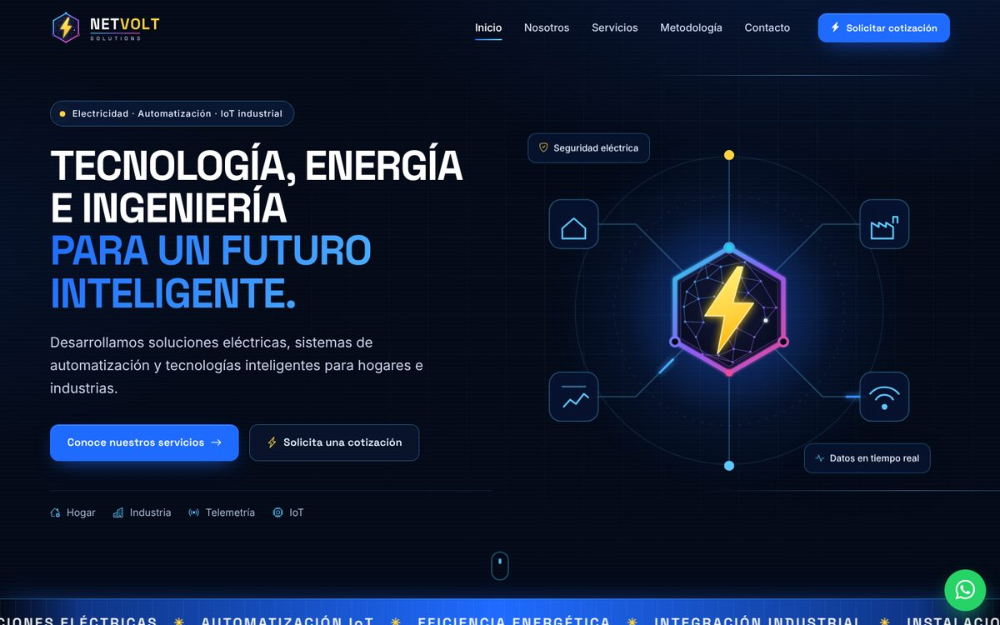
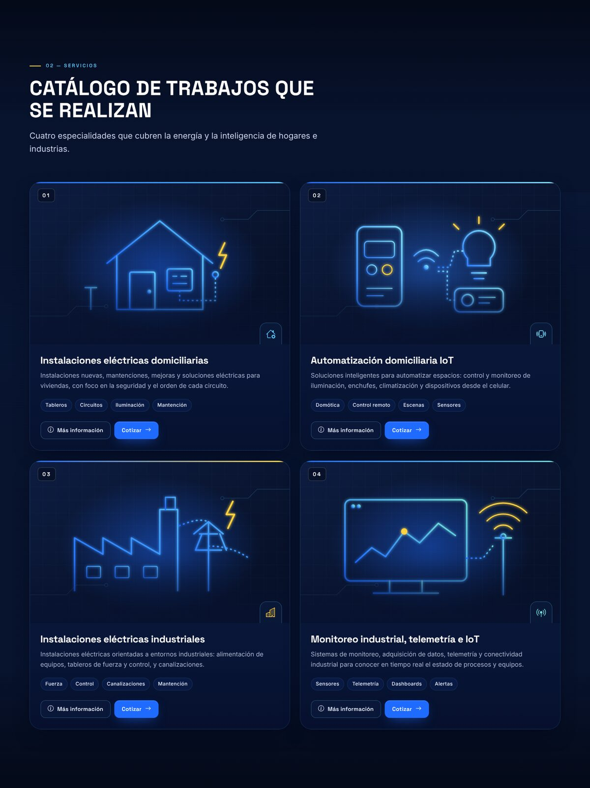
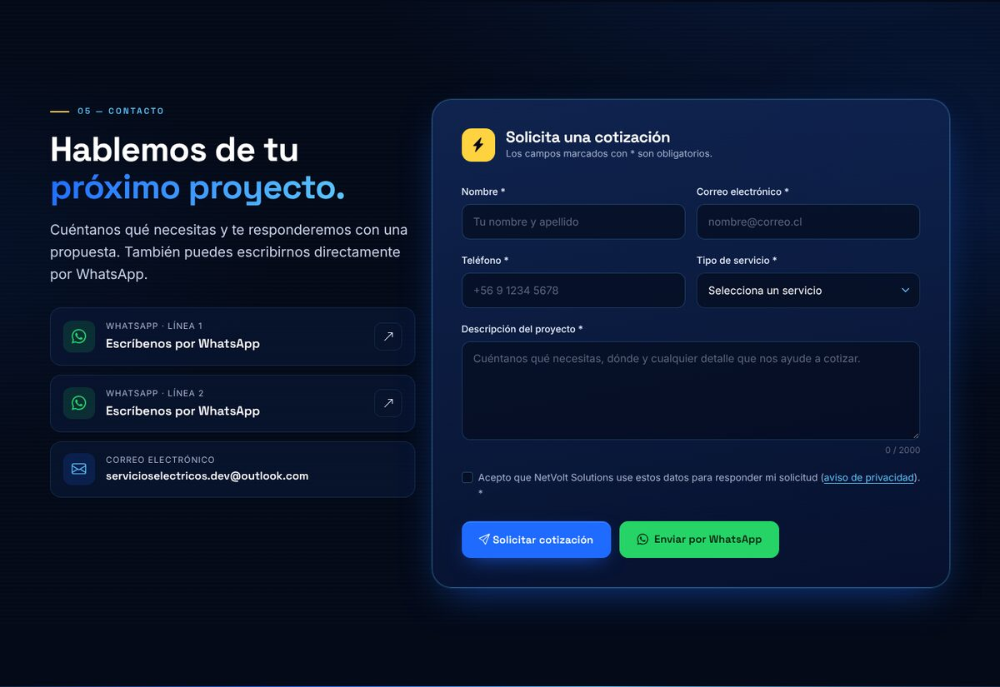
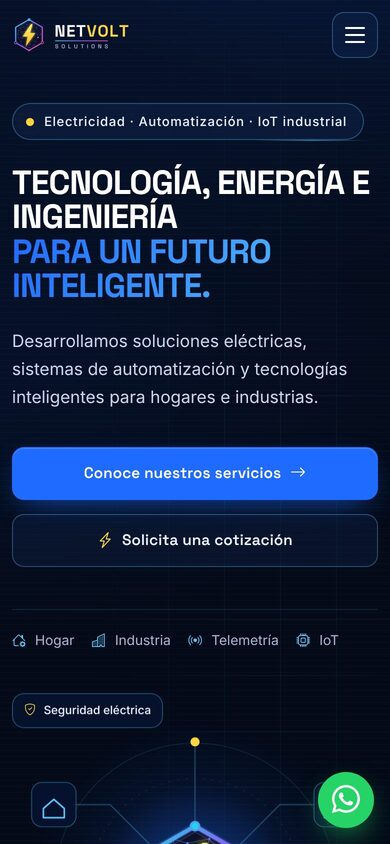

<div align="center">


# NetVolt Solutions — Sitio web corporativo

**Landing page corporativa para una empresa de soluciones eléctricas, automatización IoT e integración industrial.**

[**🌐 Ver sitio en vivo**](https://netvolt.smartgridgroup.cl)


</div>

---



## Sobre el proyecto

Proyecto desarrollado desde cero: identidad visual, logotipo, diseño de interfaz, maquetación, interacción y configuración de envío de formularios. El objetivo fue construir un sitio con nivel de agencia, sin plantillas, con una arquitectura frontend ordenada, rápida y mantenible.

**Autor:** Miguel Ignacio Echeverria Roa — Analista Programador
**Desarrollado por:** SDT — Soluciones en Desarrollo Tecnológico

## Funcionalidades destacadas

- **Identidad de marca propia:** logotipo con rayo y red de nodos, versiones para fondo oscuro y claro, favicon e ilustraciones vectoriales (SVG).
- **Diseño responsive** probado en escritorio, tablet y celular, con menú móvil accesible.
- **Huincha animada infinita** con CSS puro, sin saltos, pausa al pasar el cursor y respeto por `prefers-reduced-motion`.
- **Catálogo de servicios** con fichas dinámicas (modales) y botones que preseleccionan el servicio en el formulario.
- **Formulario de cotización real:** validación en cliente y servidor, sanitización, honeypot anti-spam, tiempo mínimo de llenado y límite de reenvíos. Envío por FormSubmit o por un endpoint PHP propio.
- **WhatsApp con números privados:** los números no se muestran en la página y se decodifican solo al abrir el chat.
- **SEO y rendimiento:** metadatos, Open Graph, datos estructurados, sitemap, carga diferida de imágenes, fuentes y librerías servidas localmente.
- **Seguridad:** Content-Security-Policy, cabeceras para Netlify y Apache, sin scripts de terceros.

## Capturas

| Catálogo de servicios | Contacto y cotización |
|---|---|
|  |  |

<p align="center"></p>

## Tecnologías

| Área | Herramientas |
|---|---|
| Estructura | HTML5 semántico, accesibilidad (ARIA, navegación por teclado) |
| Estilos | CSS3 con variables, arquitectura por capas, Bootstrap 5.3 como base de grilla |
| Interacción | JavaScript moderno (ES2020+), IntersectionObserver, Fetch API |
| Backend opcional | PHP 8 (validación, rate limiting, protección contra inyección de cabeceras) |
| Diseño | SVG generado y optimizado, tipografías Space Grotesk e Inter |
| Publicación | GitHub Pages / Netlify / cPanel |

## Arquitectura

```
├── index.html          Estructura semántica de la landing
├── css/                variables · base · layout · components · animations · responsive
├── js/                 config · main · navigation · animations · services · contact
├── api/contact.php     Endpoint alternativo de envío de correo
├── assets/             icons · img · fonts · vendor (Bootstrap)
└── docs/               Guía de configuración y publicación
```

## Derechos de autor

© 2026 Miguel Ignacio Echeverria Roa — SDT, Soluciones en Desarrollo Tecnológico. **Todos los derechos reservados.**

Este repositorio se publica **solo para exhibición como portafolio**. Puedes verlo, pero no está permitido copiar, modificar, distribuir ni usar el código, los diseños o los logotipos sin autorización escrita. Ver [LICENSE](LICENSE).

¿Te interesa un proyecto similar? Contáctame a través de mi perfil de GitHub.
